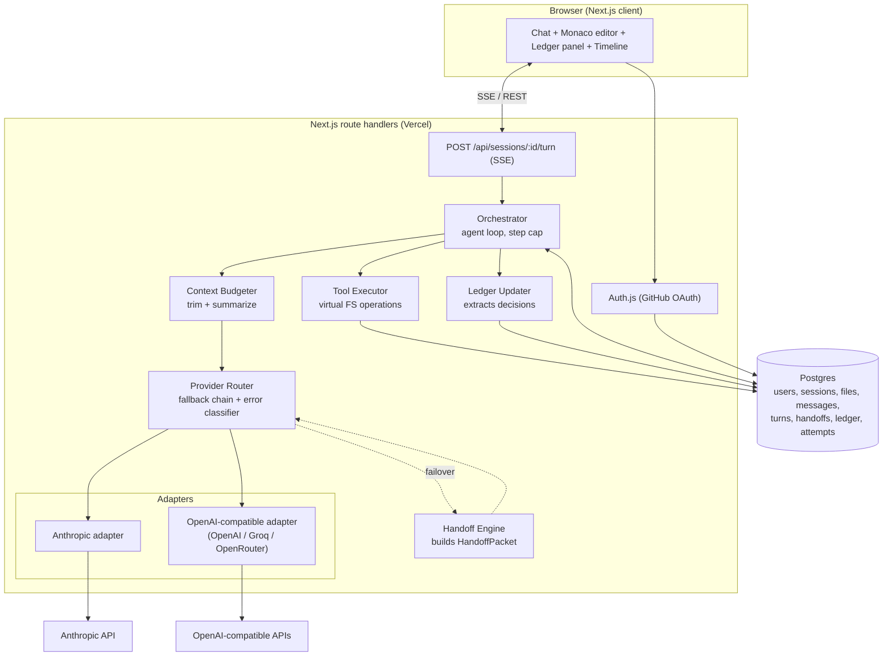
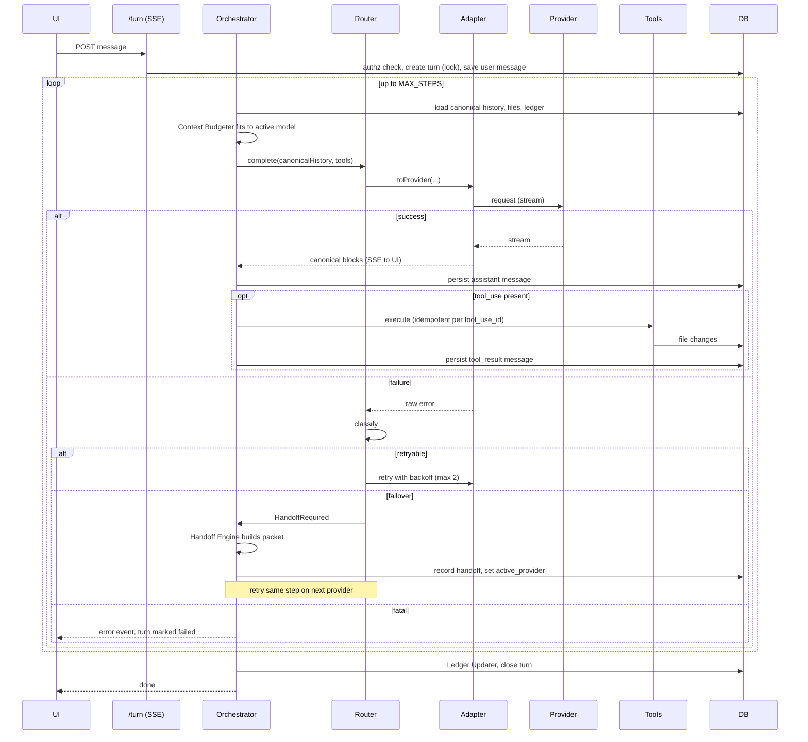

# Relay — Architecture

Relay is a browser-based AI coding agent whose sessions are **provider-neutral**. When a model provider rate-limits, times out, overflows its context window, or hits a user-set token cap, Relay hands the session to the next provider in a fallback chain. The architectural decisions, files, and history carry over. The user can also swap providers manually at any time.

This document describes how the system is built and why. For setup, see [README.md](./README.md).

---

## 1. Goals and non-goals

**Goals**

- Sessions survive provider failure without the user re-explaining anything.
- One canonical internal representation of a conversation; provider formats exist only at the edges.
- Every turn is bounded, persisted step by step, and resumable.
- Failures are classified and visible (timeline), never silent.

**Non-goals** (deliberately out of scope)

- Executing user code (no sandbox, no shell tool). The agent edits a virtual file tree only.
- Team/multi-user collaboration on a session.
- Bring-your-own-key management UI (provider keys are server-side env vars).
- Fine-grained cost accounting beyond a per-attempt usage log.

---

## 2. System overview



**Key idea:** the database holds the *truth* (canonical messages, file tree, ledger). Providers are stateless executors that are handed a rendering of that truth on every call. That is what makes switching providers cheap and safe.

---

## 3. Components

| Component | Responsibility | Location |
|---|---|---|
| **Orchestrator** | Runs the agent loop for one turn: build context → call model → execute tools → persist → repeat, up to `MAX_STEPS`. Emits SSE events. | `src/server/orchestrator.ts` |
| **Provider Router** | Holds the session's fallback chain, calls the active adapter, classifies errors, decides retry / failover / fail. | `src/server/router.ts` |
| **Adapters** | Convert canonical messages and tools to a provider's wire format, and provider responses (including streams) back to canonical. | `src/server/providers/*.ts` |
| **Error Classifier** | Maps raw provider failures to `retryable`, `failover`, or `fatal`. | `src/server/errors.ts` |
| **Handoff Engine** | Builds a `HandoffPacket`, repairs in-flight tool state, records the handoff. | `src/server/handoff.ts` |
| **Context Budgeter** | Fits history into the target model's window; summarizes older messages when needed. | `src/server/context.ts` |
| **Tool Executor** | Executes `list_files`, `read_file`, `write_file`, `delete_file` against the session's virtual file tree. Idempotent per `tool_use_id`. | `src/server/tools.ts` |
| **Ledger Updater** | After each turn, extracts decisions, constraints, and TODOs into structured entries. | `src/server/ledger.ts` |
| **Web UI** | Chat stream, Monaco editor with diff view, ledger side panel, handoff timeline, provider dropdown. | `src/app/**` |

---

## 4. Canonical data model

### 4.1 Canonical message

Stored in `messages.blocks` (JSONB). Provider-native shapes are **never** persisted.

```ts
type Block =
  | { type: "text"; text: string }
  | { type: "tool_use"; id: string; name: string; input: Record<string, unknown> }
  | { type: "tool_result"; tool_use_id: string; output: string; is_error?: boolean };

interface CanonicalMessage {
  role: "user" | "assistant";          // tool results live in a user-role message
  blocks: Block[];
  provider?: string;                   // which provider produced it (assistant only)
  model?: string;
  usage?: { inputTokens: number; outputTokens: number };
}
```

The system prompt is **not** a message. It is assembled per call from a template, the ledger snapshot, and the file manifest.

### 4.2 Tables

```mermaid
erDiagram
  users ||--o{ sessions : owns
  sessions ||--o{ files : contains
  sessions ||--o{ messages : has
  sessions ||--o{ turns : runs
  sessions ||--o{ handoffs : records
  sessions ||--o{ ledger_entries : tracks
  turns ||--o{ provider_attempts : logs
  turns ||--o{ handoffs : triggers

  users { uuid id PK; text github_id UK; text name; timestamptz created_at }
  sessions { uuid id PK; uuid user_id FK; text title; text active_provider; jsonb fallback_chain; int token_cap; text status; timestamptz updated_at }
  files { uuid id PK; uuid session_id FK; text path; text content; int version; timestamptz updated_at }
  messages { uuid id PK; uuid session_id FK; int seq; text role; jsonb blocks; text provider; text model; jsonb usage; uuid turn_id FK }
  turns { uuid id PK; uuid session_id FK; text status; int step_count; timestamptz started_at; timestamptz ended_at }
  handoffs { uuid id PK; uuid session_id FK; uuid turn_id FK; text from_provider; text to_provider; text reason; jsonb packet; timestamptz created_at }
  ledger_entries { uuid id PK; uuid session_id FK; text kind; text body; text status; int source_seq; uuid superseded_by }
  provider_attempts { uuid id PK; uuid turn_id FK; text provider; text outcome; text error_class; int latency_ms; int tokens_in; int tokens_out }
```

**Constraints that matter**

- `UNIQUE (session_id, seq)` on `messages` gives a total order and prevents double-writes.
- `UNIQUE (session_id, path)` on `files`; every write carries an expected `version` (optimistic concurrency).
- At most one `turns` row per session with `status = 'running'` (partial unique index), so concurrent turns on one session are rejected.
- Every query is scoped by `user_id` through `sessions`.

---

## 5. Turn lifecycle



**Invariants**

1. Every step is persisted *before* the next begins. If the function is killed mid-turn, the session is consistent and the client can call `POST /turn/resume`.
2. Every `tool_use` has a matching `tool_result` before any model call (see §7.3).
3. A step is retried on the new provider at most once per handoff; the chain is exhausted at most once per step, then the turn fails.

---

## 6. Provider Router and error classification

The router owns the fallback chain (`sessions.fallback_chain`, e.g. `["anthropic:claude-…", "groq:llama-…", "openrouter:…"]`).

| Signal | Class | Action |
|---|---|---|
| HTTP 429, quota exceeded, user token cap reached | `failover` | Hand off immediately; honor `Retry-After` only for retry on the same provider if it is the last in the chain |
| HTTP 5xx, network error, timeout | `retryable`, then `failover` | Up to 2 retries with exponential backoff and jitter, then hand off |
| Context-length exceeded | `failover` (to a larger window) or compress | Budgeter re-trims; if still too large, hand off to a model with a larger window |
| 401 / 403 (bad key) | `failover` + flag | Skip provider for the session, show a warning in the timeline |
| 400 malformed request | `fatal` | Surface to the user; indicates an adapter bug |
| Mid-stream disconnect | `retryable` | Discard the partial assistant message; retry the step |

Every attempt is written to `provider_attempts` (outcome, class, latency, tokens). That table drives the timeline and is the debugging record.

**Dev-only failure injection:** `X-Relay-Simulate: 429@anthropic` (honored only when `ENABLE_SIMULATION=true`) forces the classifier path so handoffs are deterministic in tests and the demo.

---

## 7. Translation layer (the hard part)

Adapters implement:

```ts
interface ProviderAdapter {
  id: string;
  capabilities: { contextWindow: number; parallelTools: boolean; };
  toRequest(input: { system: string; messages: CanonicalMessage[]; tools: ToolDef[] }): ProviderRequest;
  stream(req: ProviderRequest, signal: AbortSignal): AsyncIterable<CanonicalDelta>;
  countTokens(messages: CanonicalMessage[], system: string): number;   // estimate
}
```

### 7.1 Format differences handled

| Concern | Anthropic | OpenAI-compatible | Canonical |
|---|---|---|---|
| System prompt | top-level `system` | first message, `role: "system"` | assembled per call, not stored |
| Tool call arguments | parsed object | **JSON string** (may be malformed or partial in streams) | parsed object |
| Tool results | `tool_result` block inside a `user` message | separate `role: "tool"` message | `tool_result` block in a `user` message |
| Role alternation | strict user/assistant | permissive | adapter merges or splits as needed |
| Tool IDs | `toolu_…` | `call_…` | preserved; remapped if a provider rejects a foreign format |
| Parallel tool calls | multiple `tool_use` blocks | multiple `tool_calls` | multiple `tool_use` blocks |

### 7.2 Streaming normalization

Both adapters emit the same `CanonicalDelta` events (`text_delta`, `tool_use_start`, `tool_input_delta`, `tool_use_end`, `usage`, `stop`). Tool-call argument fragments are accumulated and parsed **only at `tool_use_end`**; unparseable arguments become an `is_error` tool result so the model can self-correct instead of crashing the turn.

### 7.3 In-flight repair during handoff

A provider can fail after emitting a `tool_use` but before its result exists. Before building a packet, the Handoff Engine normalizes the tail of history:

- `tool_use` with no `tool_result` → synthesize `tool_result { is_error: true, output: "Interrupted by provider failover; re-issue if still needed." }`, or drop the unexecuted call if it was never persisted.
- Partial assistant message from an aborted stream → discarded.
- Consecutive same-role messages → merged.

Adapter fixtures (§12) test every one of these cases.

---

## 8. Handoff Engine and the state ledger

### 8.1 HandoffPacket

```ts
interface HandoffPacket {
  system: string;                     // base prompt + handoff preface
  ledger: LedgerEntry[];              // active decisions/constraints/TODOs
  fileManifest: { path: string; version: number; bytes: number }[];  // contents fetched via read_file on demand
  summary?: string;                   // compressed older history
  recentMessages: CanonicalMessage[]; // token-budgeted tail, repaired
  reason: string;                     // e.g. "429 rate_limit on anthropic"
}
```

The packet is built from the database, not from the failed provider's response, so a handoff works even when the old provider is completely down. It is stored in `handoffs.packet` for auditability.

### 8.2 Why a ledger instead of "just send the whole history"

Raw history is large, provider-specific in cost, and may exceed the next model's window. Decisions made 30 messages ago (e.g. "use Drizzle, not Prisma"; "all routes must be authed") are exactly what a fresh model forgets after truncation. The ledger is a compact, structured memory that is **always** included, regardless of how much history is trimmed.

- **Kinds:** `decision`, `constraint`, `todo`, `fact`.
- **Update:** after each turn, a cheap model call receives the new messages plus current active entries and returns a JSON diff (`add`, `update`, `supersede`). The output is validated with Zod; invalid output is discarded and the ledger is left unchanged (it is an optimization, not a correctness dependency).
- **Supersession:** entries are never edited in place; a changed decision links to its replacement via `superseded_by`, so the panel can show history.

### 8.3 Context budgeting

1. Compute the target model's budget: `contextWindow − reservedOutput − system − ledger − manifest`.
2. Keep the newest messages that fit, always preserving complete tool-use/tool-result pairs.
3. Messages older than the kept window are summarized (cached in `messages` as a summary row and reused) and prepended.
4. If the budget is still exceeded, fail over to a larger-window provider; if none exists, return a clear error.

Token counts are estimates (provider tokenizers differ); the budgeter keeps a safety margin and the classifier treats a context-length error as recoverable.

---

## 9. Tooling and the virtual file system

The agent can only act through four tools, each operating on `files` rows for the current session:

`list_files()`, `read_file(path)`, `write_file(path, content, expectedVersion?)`, `delete_file(path)`

- **No host filesystem access, no code execution.** The "workspace" is database rows.
- **Path validation:** normalized, relative, no `..`, no absolute paths, length and depth limits, allowed character set.
- **Limits:** max file size, max files per session, max tool calls per turn.
- **Idempotency:** execution is keyed by `(turn_id, tool_use_id)`; a retried step does not apply a write twice.
- **Concurrency:** writes use `version` checks; the UI editor saves with the version it loaded, and a conflict is reported rather than overwritten.
- **Diffs:** each `write_file` result returns before/after so the UI can render a diff and the agent can see what it changed.

---

## 10. API surface

| Method & route | Purpose |
|---|---|
| `GET/POST /api/auth/*` | Auth.js GitHub OAuth |
| `GET /api/sessions` | List the user's sessions |
| `POST /api/sessions` | Create a session (title, fallback chain) |
| `GET /api/sessions/:id` | Session, messages, ledger, handoffs |
| `POST /api/sessions/:id/turn` | Run a turn; **SSE** stream of events |
| `POST /api/sessions/:id/turn/resume` | Resume an interrupted turn from its last persisted step |
| `PATCH /api/sessions/:id/provider` | Manual provider swap (records a `manual` handoff) |
| `GET/PUT /api/sessions/:id/files/*path` | Read/save a file from the editor (versioned) |
| `DELETE /api/sessions/:id` | Delete a session and its data |

**SSE event types:** `step_start`, `text_delta`, `tool_call`, `tool_result`, `file_changed`, `attempt_failed`, `handoff`, `ledger_updated`, `done`, `error`.

All inputs are validated with Zod at the route boundary. Each route resolves the session through `WHERE id = $1 AND user_id = $2` before doing anything else.

---

## 11. Security

- **AuthN/Z:** GitHub OAuth via Auth.js; every resource access is ownership-checked server-side. Unauthorized and nonexistent resources return the same 404 to avoid enumeration.
- **Secrets:** provider keys exist only in server environment variables. They are never sent to the client, never logged, and `.env.example` is the only committed env file. Error messages returned to the client are sanitized (no upstream bodies containing headers or keys).
- **Prompt injection:** file contents and tool results are untrusted data. The agent's blast radius is limited to the session's virtual files, so a malicious file cannot reach other users' data, the host, or secrets.
- **Abuse limits:** per-user rate limiting on `/turn`, per-turn step and token caps, request body size caps.
- **Data:** no secrets or credentials are stored in `messages` or `files` by Relay itself; users are warned not to paste credentials into sessions.

---

## 12. Reliability and testing

**Reliability**

- Step-level persistence plus `turn/resume` handles serverless time limits and client disconnects.
- Single running turn per session (partial unique index) prevents duplicate or interleaved agent runs.
- Bounded loops: `MAX_STEPS`, per-attempt timeout via `AbortController`, capped retries.
- The UI always renders loading, empty, and error states, and shows handoffs and failed attempts in the timeline.

**Testing**

- **Adapter golden fixtures:** canonical → provider → canonical round-trips covering text-only, single tool call, parallel tool calls, tool error results, orphaned `tool_use`, consecutive same-role messages, malformed streamed arguments.
- **Router/classifier table tests:** each error signal maps to the expected action.
- **Handoff tests:** mid-tool-call failure produces a valid, provider-acceptable history on the next provider.
- **Tool tests:** path traversal attempts, version conflicts, idempotent replays.
- **Authorization tests:** cross-user access returns 404 for every route.

---

## 13. Deployment

- **Hosting:** Vercel (Next.js route handlers with `maxDuration` set for the turn route).
- **Database:** managed Postgres (Neon or Supabase), migrations via Drizzle (`drizzle-kit`).
- **Config:** environment variables documented in README (`DATABASE_URL`, `AUTH_SECRET`, `AUTH_GITHUB_ID`, `AUTH_GITHUB_SECRET`, `ANTHROPIC_API_KEY`, `OPENAI_COMPAT_*`, `ENABLE_SIMULATION`).
- **CI:** type-check, lint, and unit tests on every push.

---

## 14. Key decisions and trade-offs

| Decision | Alternative | Why |
|---|---|---|
| Store canonical messages, render per provider | Store native provider payloads | Provider-agnostic history makes handoff a rendering problem rather than a migration problem; adding a provider means writing one adapter. |
| Ledger as structured memory | Rely on raw history or free-text summaries only | Survives truncation, is inspectable and editable by users, and is cheap to inject. |
| Virtual FS in Postgres | Real sandboxed containers | Removes the largest security and ops risk for a 48-hour build; the product's core value (continuity across providers) does not depend on code execution. |
| SSE + step-level persistence | WebSockets or a job queue | Fits serverless hosting; resumability replaces long-lived connections. A queue would be the next step for long-running agents. |
| Two adapter families (Anthropic, OpenAI-compatible) | Many bespoke adapters | OpenAI-compatible covers most other providers; two real, tested adapters demonstrate the abstraction honestly. |
| Ledger update is best-effort | Block the turn on ledger success | A failed extraction must never fail a user's turn. |

## 15. Known limitations

- Token counting is approximate across providers.
- Handoff quality depends on the ledger extractor; it can miss implicit decisions.
- No code execution, so the agent cannot run tests on what it writes.
- Single-region, single-user sessions; no real-time collaboration.
- Summaries of old history are lossy by nature.

## 16. Future work

Background job queue for long agent runs, sandboxed execution, user-editable ledger with pinning, more adapters (Gemini, local models via Ollama), cost-aware provider selection, and team sessions.
